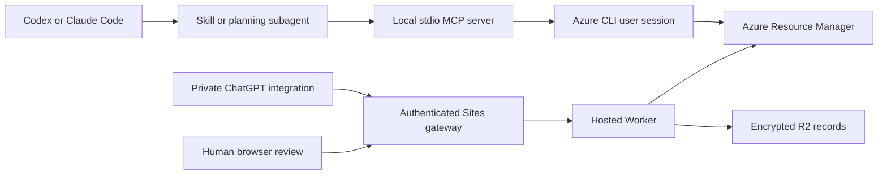

# Internal architecture

Project creator: **Leiner Arce ([@lsaj08](https://github.com/lsaj08))**.

## Two independent runtime paths

Local mode has no Sites dependency, application secret, approval endpoint, or Azure resource mutation tool. Hosted mode has its own identity, OAuth connection, project records, and browser approval. A local preview does not become a hosted plan or approval; the hosted workflow must prepare and approve its own exact payload.

## Local components

| Component | Responsibility |
| --- | --- |
| [server.mjs](../local/server.mjs) | Startup option parsing, MCP lifecycle/version negotiation, JSON-RPC routing, and bounded newline-delimited stdio |
| [service.mjs](../local/service.mjs) | Seven fixed tools, startup-bound scope, input validation, template policy, temporary JSON, and output projection |
| [azure-cli.mjs](../local/azure-cli.mjs) | Lazy CLI discovery, isolated arguments, Windows launcher handling, execution/output limits, and error suppression |
| [guard.js](../worker/guard.js) | Shared ARM template policy, also used by the hosted backend |
| [SKILL.md](../skills/azure-arm-guard/SKILL.md) | Reusable client workflow with human deployment handoff |
| [Codex agent](../integrations/codex/azure-reviewer.toml) / [Claude agent](../integrations/claude/azure-reviewer.md) | Optional bounded inspection and planning roles |
| [install-integration.mjs](../scripts/install-integration.mjs) | Copies project-level skill/reference/agent files; refuses conflicts and linked destination parents |

The installer does not register MCP, authenticate, modify global client configuration, or update an existing installation. MCP configuration points to a stable absolute server path. Subscription/group/type options belong to the trusted operator at startup; changing them requires a client restart.

### Request flow

1. The client initializes MCP and sends its initialized notification before tool discovery/calls.
2. The service accepts only tool-specific arguments; it rejects attempts to supply scope overrides or arbitrary commands.
3. Inventory calls construct fixed CLI commands and return selected metadata fields.
4. Validation/what-if require a configured subscription, existing group, and explicit allowed types. The shared policy checks resource bodies, supplied parameter values, parameter defaults, and other root fields before Azure is contacted.
5. Non-confidential JSON is written to temporary files so template bodies do not enter command-line arguments. Cleanup runs after normal success/failure. What-if returns resource IDs/change types only.
6. CLI errors become sanitized tool errors. Successful tool results are JSON inside MCP text content; stdout contains protocol messages only.

MCP annotations describe intended tool behavior; the dispatcher enforces the absence of mutation/token/command tools. A parent agent with independent shell access is outside that enforcement boundary. See [SECURITY.md](../SECURITY.md).

## Hosted components

The hosted Worker runs behind a trusted authenticated Sites gateway and uses encrypted R2 records for OAuth state, short-lived Azure access tokens, project proposals, and plans. Project approval selects a group and types; deployment approval consumes an exact saved plan before its ARM PUT. Group creation uses a fixed internal template and separate human approval. The local tool surface cannot trigger those hosted approvals.

[guard.js](../worker/guard.js) is authoritative. The build generates [index.js](../worker/index.js) and the hosted `dist` artifact. Editing generated copies alone creates drift; regenerate them after changing the source. Deploying the hosted artifact is a separate action from pushing GitHub changes.

## Maintenance rules

- Preserve the separation between process configuration and model-supplied tool arguments.
- Reuse the shared ARM policy and add a regression before relaxing or correcting it. Run both local and hosted security checks after a policy change.
- Keep credentials in the CLI/platform credential store. Do not add tokens, secret files, private account identifiers, or raw provider responses to examples or fixtures.
- Keep client agent/skill packages synchronized with the actual tool catalog; preserve project configuration during installation/upgrades.
- Record verified behavior and pending integration gates in [VERIFICATION.md](VERIFICATION.md). Passing simulated tests does not establish live Azure or client compatibility.
